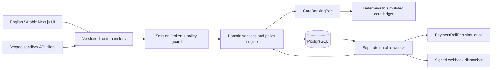

# 03 — Architecture, persistence and execution design

## Stack and decision rules

Use Next.js App Router, React, strict TypeScript, Node.js LTS supported by the chosen stable Next.js version, pnpm with an exact `packageManager` field and committed lockfile. Verify current official compatibility when scaffolding; pin tested versions in `.node-version`/`engines`, never put an untested future version into docs. Prefer Node 24 LTS if compatible. Use PostgreSQL 16+ with Prisma migrations and generated client. No SQLite substitute for locking/concurrency tests. Run a separate TypeScript worker using the same domain services and database; no serverless timer assumption. A PostgreSQL-backed jobs/outbox implementation avoids needing Redis in R1. Use a durable job library if it supports the explicit transactional/outbox guarantees, otherwise implement bounded claims, retries and leases carefully.

Use Zod at process boundaries; React Hook Form for complex forms; a maintained authentication library; Argon2id (or supported equivalent memory-hard password hashing) for sandbox passwords; Tailwind CSS and accessible Radix/shadcn-style primitives; TanStack Table for data tables; next-intl for locale routing/messages; Vitest for domain/integration tests and Playwright for end-to-end tests. Use a maintained bounded XLSX parser after license/security review, `csv-parse` or equivalent for CSV and a server-side PDF library with bundled Arabic-capable font/shaping verified by a visual test. Small charting dependency only where chart conveys real time-series data. Do not add state, service or animation frameworks without a concrete use.

No microservices, GraphQL, event bus cluster, Elasticsearch, external cache, blockchain, LLM workflow or home-grown identity protocol in R1. PostgreSQL-backed rate limit counters are sufficient; worker persistence is essential.

## Boundaries



UI calls the same REST operations described in OpenAPI. Read-only server components may call shared query services if projection/authorization matches API; mutations must not bypass canonical command validation. Route handlers contain authentication, parse, dispatch and HTTP mapping only. Domain modules must be importable without Next.js to run worker/tests.

```text
src/
  app/[locale]/(auth)/...           login, invitation
  app/[locale]/(corporate)/...      permitted corporate workspace
  app/[locale]/bank/...             explicit bank workspace
  app/api/v1/...                    versioned route handlers
  components/ui/                   accessible primitives
  features/{payments,payroll,...}/  feature UI, forms and view models
  server/auth/                     sessions, context, credential verification
  server/policy/                   agreement/limits/approval evaluators
  server/domain/{agreements,payments,batches,collections,administration,reports}/
  server/db/                       client, scoped repositories, transactions
  server/adapters/{core,rails,notifications,storage}/
  server/jobs/                     handlers, claims, retry policy, outbox
  server/audit/                    redaction, immutable append
  contracts/                       Zod, DTOs, error codes and event schemas
  i18n/                            en/ar messages, currency/date formatting
worker/index.ts
prisma/schema.prisma
prisma/migrations/
prisma/seed.ts
tests/{unit,integration,contract,e2e,fixtures}/
openapi/al-qarib-v1.yaml
scripts/                           seed/reset-demo/smoke/worker diagnostics
docs/                              plan, actual runbook and evidence
```

Do not import server-only secrets or database modules into client bundles. Add explicit server-only boundaries. Avoid circular dependency by keeping contracts/types separate from orchestration. Prefer module-scoped repositories over arbitrary Prisma access in pages.

## Canonical interfaces

```ts
type Currency = "LYD" | "USD" | "EUR";
type Money = Readonly<{ currency: Currency; minor: bigint }>;
type ExecutionResult =
  | { kind: "confirmed"; coreReference: string; bookedAt: string }
  | { kind: "accepted"; railReference: string }
  | { kind: "rejected"; code: string; retryable: boolean }
  | { kind: "unknown"; executionReference: string };
// Runtime validation, tenant scope and complete parameter schemas required.
interface CoreBankingPort {
  getAccounts(context: AuthorizedContext): Promise<CanonicalAccount[]>;
  getBalance(context: AuthorizedContext, accountId: string): Promise<Balance>;
  validateBeneficiary(context: AuthorizedContext, input: AccountReference): Promise<NameMatch>;
  reserveDebit(context: AuthorizedContext, instruction: DebitReservation): Promise<ReservationResult>;
  execute(context: AuthorizedContext, instruction: CoreInstruction): Promise<ExecutionResult>;
  inquire(context: AuthorizedContext, executionReference: string): Promise<InquiryResult>;
  releaseReservation(context: AuthorizedContext, reference: string): Promise<void>;
  getPostings(context: AuthorizedContext, range: PostingQuery): Promise<PostingPage>;
}
```

These are conceptual contracts; define complete immutable DTOs during phase 0. A PaymentRailPort owns `submit`, `inquire`, event validation and cut-off decisions; do not conflate rail acceptance and core booking. Simulated external transfer starts with a core funds reservation, rail acceptance/status, then confirmed balanced booking on settlement. Until settled, retain reserved funds; on definitive pre-booking rejection release. Test timeouts before and after booking. Implement return as a new idempotent compensating instruction. For real adapters later, confirm bank-specific debit/settlement sequencing rather than assuming the simulation sequence is universal.

## Data dictionary and invariants

All mutable records have `id`, `createdAt`, `updatedAt`, `version`; financial and governance records are never hard deleted. IDs opaque, immutable UUID/ULID. UTC `timestamptz` for instants; explicit `date` for businessDate; bank calendar supplies boundaries. Define SQL bigint range checks and currency exponent validation at boundaries.

| Entity | Minimum fields and relationships | Database/behavior requirements |
|---|---|---|
| Bank | name, businessTimezone, currency config, sandbox mode | R1 Africa/Tripoli, not host/user timezone |
| Corporate | bankId, legalName, segment, status | Every child belongs to same bank |
| Person / Session | normalized login, hash/provider ID, active, expiry/revocation | Unique login, revocable sessions, no seeded production login |
| Membership | personId, bankId, corporateId?, roles, status, grantVersion | Unique context membership; bank and corporate grants distinct |
| AccountGrant | membershipId, accountId, read/debit/approve/report rights | Composite scope FK prevents cross-corporate grants |
| ModuleDefinition | catalogueId, domain, deliveryStatus, transactionTypes | 33 deterministic entries; unsupported types cannot execute |
| Agreement / AgreementVersion | corporateId, status, version, validity, signature evidence, proposal actor/checker | Immutable proposed/effective contents; no overlapping effective periods |
| ModuleEntitlement | agreementVersionId, moduleId, allowedTypes, accounts, currency | Valid combinations; unique module per version |
| LimitRule / FeeRule | scope, type, metric, period, currency, value, provenance, effective interval | bigint nonnegative; explicit zero vs unset, no mixed unit comparisons |
| ApprovalRule | entitlement/type/currency, min/max, checkerCount, bankFloor | Non-overlap, complete supported range, bank min enforced |
| GovernanceProposal / Vote | kind, target/revision, immutable payload/hash, proposer, voter, outcome, reason | Unique proposal+person vote; different proposer/approver; expected version |
| Beneficiary | corporateId, scheme, account ref, display name, match status, archivedAt | Snapshot copied to payment; no historical mutation |
| Payment / PaymentRevision | module/type, source/destination, minor/currency, fee, purpose, schedule, maker, hash, policy version, state, releaseBlockCode | Tenant-composite FKs, optimistic version, immutable after submit |
| ApprovalVote | paymentRevisionId/batchRevisionId, personId, decision, policyVersion, timestamp | Unique revision+person; terminal decisions versioned |
| UsageCounter | corporate/user/module/type scope, periodStart/end, metric/currency, consumed/reserved | Unique bucket key; lock atomically across all applicable counters |
| LimitReservation | executionId, counterId, minor/items, state, window | Unique execution+counter; consume/release once |
| Batch / BatchRevision | kind, corporate/source/currency, fileDigest, period, acceptedRowsHash, totals/fees, maker, state | Derived counters; immutable accepted set; no duplicate counting |
| BatchRow | batchId, stable input row number, employee/beneficiary ref, amount, error codes, state, instructionId | Unique batch+line; sensitive payroll fields restricted |
| PayrollEmployee / PayrollDetail | employeeCode, protected name/account, component amounts, period/payslip ref | Unique corporate+employee; explicit salary detail access path |
| BusinessInstruction | corporateId, businessKey, originalRow, currentAttempt | Unique corporate+businessKey; prevents duplicate successful salary/row execution |
| ExecutionAttempt | instructionId, stable core ref, rail ref, attempt count, state, timestamps, sanitized error | Unique core ref; no overlapping active retry per instruction |
| CoreAccount / CoreHold | simulated bank/core owner, currency, hold ref, amount, state | Separate simulated-core namespace/schema; idempotent hold reference |
| CoreJournal / CoreEntry | instruction reference, debit/credit account, signed minor, currency, businessDate | Unique external execution reference; entries sum zero per currency/journal |
| Customer | corporateId, normalized code, name/company/mobile/tags/address, archivedAt | Unique corporate+code; cannot overwrite referenced code |
| InvoiceReference | corporate/customer, reference, amount, dueDate, status | Minimal collection context; not a separate product ledger |
| Deposit | corporate/customer/branch, method, amount, threshold flag, state, teller/manager, cheque ref, core ref | Unique bank intake ref; clearance event processed once |
| Receipt / Report | owner scope, reference/status, storage key, checksum, expiry, projection version | Authenticated retrieval and sanitized filename; receipt supersessions linked |
| Job / OutboxEvent | type, aggregate ref, payload version, availableAt, attempts, lockedUntil, state | Unique dedup key; claim with row lock; event creation atomic with mutation |
| WebhookSubscription / Delivery | corporate, HTTPS URL, scopes/events, encrypted signing secret, eventId, attempts/status | Destination controls, delivery HMAC and replay audit |
| ApiCredential / IdempotencyRecord | corporate, hashed token, scopes/expiry; request key/hash/result pointer | Show token once; scope-method-route+tenant+key uniqueness |
| AlertRule / Notification | scoped account, threshold, event key, recipient/readAt | Dedup recipient+event; redacted content |
| ReconciliationRun / Break | bank/date, source refs, mismatch kind, expected/actual, resolution | Preserve runs and breaks; resolution reason/actor |
| AuditEvent | append-only scope, actor, action, target, correlation, sanitized changes, result/time | Separate migration and runtime privileges; index scope/time/target |

Schema is a minimum contract, not a mandate for one table per label. Any consolidation must retain constraints and evidence. Use relational fields for frequently queried/authorized values; JSON for immutable versioned policy snapshots only. No opaque “everything JSON” table.

## Execution transaction boundaries

1. **Submit transaction:** validate authorization/agreement, canonicalize, enforce idempotency, persist immutable proposal and audit/outbox. Do not call external adapter inside a long DB transaction.
2. **Vote transaction:** lock proposal/version, validate eligible voter, insert unique vote, determine quorum and transition once, create release job/outbox in same commit. No HTTP response claims settlement.
3. **Release transaction:** claim state/version, re-evaluate policy, reserve all usage counters, persist execution intent with stable reference, commit. Acquire core funds reservation idempotently outside platform transaction. Recovery checks missing reservation acknowledgment by reference.
4. **Adapter call:** use intent reference, bounded timeout and classified outcome. A crash between call and acknowledgment leaves recoverable intent. Never hold DB locks while waiting for network.
5. **Outcome transaction:** compare-and-set execution, record authoritative adapter result, consume/release usage, persist state/audit/event atomically. Simulated core posting is independently idempotent; platform can repair acknowledgment by inquiry. Handle money hold capture/release by its stable reference.
6. **Scheduled/batch handling:** deterministic child IDs; reservations allocated once per child; only worker claims execute. Completed state derived from children. Queue and outbox duplication must not duplicate a payment.

Use a documented lock order, bounded serialization retries with jitter and unique constraints as the last defense. Locks guard limits and state, adapter idempotency guards external effects. Both are required.

## Worker behavior

Poll due jobs with `FOR UPDATE SKIP LOCKED` or equivalent library guarantee; lease claims, heartbeat for long imports, bounded attempt count. Retry only known safe/transient operations (inquiry, delivery, pre-posting temporary outage) with exponential delay and deterministic-test option. Exhausted jobs move to dead-letter/action-required view. Unknown payment outcomes create inquiry jobs and retain reservations. On restart reclaim stale leases without executing money twice. Shutdown finishes or releases claims, never erases in-flight jobs. Service actor includes original tenant and instruction reference; worker reconstructs authorized policy context and does not trust raw queued tenant JSON.

## Simulation design

Use explicit fixture/scenario metadata per test account/instruction, not random failures or magic amount values hidden in UI. Scenarios: immediate success, delayed ACH success, name mismatch, blocked account, insufficient funds, rail offline before submission, definitive rejection, timeout before processing, timeout after successful booking, duplicate event, out-of-order event, cheque cleared/returned and late return. Simulator is accessible only in sandbox to authorized operations/test fixtures. No arbitrary public endpoint may change a production outcome. Use a Clock port and seeded deterministic IDs where needed in tests.

## Nonfunctional targets

- Linux fresh checkout reproducibility; production build must not require live core credentials.
- With documented 2-vCPU/4-GiB baseline and local database, seed 10,000 statement entries and measure: paginated read p95 <500ms, write acknowledgment p95 <1s excluding adapter work, 100-row validation <5s, 1,000-row validation <30s, async processing acknowledges quickly. These are targets; report actual commands/results and hardware, not a fabricated SLA.
- Bounded pagination default 25/max 100; indexed scoped date/status/reference queries; no unbounded downloads or N+1 per-row adapter calls without bounded concurrency (default 5).
- App restart must preserve proposals, votes, jobs, rows, receipts metadata and audit; worker restart must recover pending execution.
- No external CDN/font dependency needed for essential UI or PDF in local/offline evaluation.

## Web/mobile PWA architecture

Document 12 defines the mandatory manifest, icons, reviewed service worker/public-asset allowlist, generic offline document, update UX, session revalidation and responsive mobile behavior. Use the same Next.js application and domain APIs for browser and installed modes; no separate mobile backend. Authenticated HTML, RSC/Flight, APIs and private artifacts bypass worker caches. Production-mode worker tests are required; development-only rendering is insufficient evidence.
